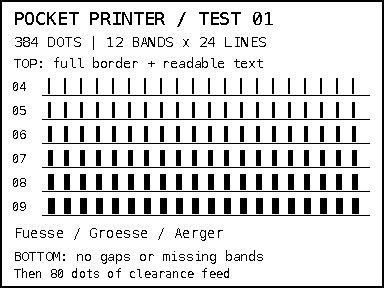

# Copilot Pocket Printer

A portable macOS foundation for printing your own bitmap cards on the Tronic
5890 thermal pocket printer without its vendor app. GitHub Copilot, Claude Code,
another AI client, or a person can use the same CLI. A daily card is one future
example, not a hard-coded product or a requirement to use Copilot or WorkIQ.

The end-to-end goal remains **printing from the Copilot app without copying
commands into Terminal**. Terminal is acceptable for milestone 1 hardware
testing only; it is not a substitute for that final in-app workflow.

**Milestone 1's native Terminal physical-print checkpoint passed:** the user
printed the test pattern once, and a photograph confirmed complete, readable
output. **App-origin printing is not verified:** the observed Copilot app host
still cannot initialize Bluetooth. The one-print approval is consumed; work
stops here. There is no renderer for live data, MCP server, canvas, calendar
integration, or automation yet.

## Build and offline checks

Requires macOS 13 or later and a Swift 5.9+ toolchain. Full Xcode provides the
XCTest runtime used by the unit tests. Do not install system components without
the machine owner's approval. The first build downloads the pinned Swift
Package dependency; subsequent offline commands do not access a network.

```sh
swift build
swift test
BIN_DIR="$(swift build --show-bin-path)"
BIN="$BIN_DIR/printer-cli"
"$BIN_DIR/printer-cli-checks"
"$BIN" --help
"$BIN" print examples/test-pattern.png --dry-run
"$BIN" feed 80 --dry-run
python3 scripts/smoke_test.py "$BIN"
```

`--show-bin-path` avoids assuming a particular SwiftPM build-system directory.
The `printer-cli-checks` executable needs no XCTest runtime or extra package.
It runs the **same shared assertions** as the XCTest wrapper, prints each
result, and exits nonzero if any assertion fails. Both runners cover command
parsing, German transliteration,
thresholding, transparency, row/bit order, input limits, activation boundaries,
24-line bands, credit-frame classification, printer selection, metadata
preflight and the explicit physical-operation gate. Inert transport checks cover
notification readiness, synchronous Combine delivery, status-only command
batches, unrelated battery drains, outstanding response callbacks, deadlines,
cancellation and no replay. They do **not** prove radio delivery or paper output.
The repair fork separately checks its actual additive-credit state and adapter
wiring without Bluetooth hardware.
The Python smoke checks exercise executable exit codes and actual file IO,
including invalid input and guarded physical commands. They use only the
standard library. Neither suite scans or connects to Bluetooth.

On the development Mac, `swift build` succeeds but `swift test` cannot import
`XCTest`: only Command Line Tools are installed, without XCTest or Swift Testing.
The native SwiftPM test runner encounters the same missing module. No system
installation was attempted. **24/24 shared Swift behavioral checks and 7/7
Python process-level smoke checks pass.** `swift test` itself remains unavailable
here, not passed; run its XCTest wrapper on a Mac with that runtime.

## CLI

| Command | Current behavior |
|---|---|
| `print <png> --dry-run` | Validates, thresholds and assembles an offline print job; no Bluetooth access. |
| `feed [dots] --dry-run` | Assembles activation, feed and stop segments; default 80, range 1...255. |
| `print <png>` / `feed [dots]` | Without `--device <uuid> --confirm-paper`, fail with `paper_approval_required`, exit 6, before Bluetooth access. With separate user approval and those flags, submit one bounded physical job. |
| `status [--device <uuid>] [--timeout <seconds>]` | Metadata preflight, then bounded advertisement scan. Never connects or sends commands. |
| `status --device <uuid> --connect` | Connect, confirm FF00/FF02 plus both FF01/FF03 notifications, send activated status queries, collect replies, and disconnect. No raster, feed or settings requested. |
| `test-pattern <new.png>` | Generates a local 384x288 PNG; refuses to overwrite an existing file. |

Use `--help` for accepted options. `status` waits the full scan window (default
8 seconds, range 1...30, plus at most 5 seconds for Bluetooth startup) so a
stronger or earlier advertisement does not silently win. Automatic selection
requires the exact name `Mini Pocket Printer_BLE`. Multiple matches fail;
`--device` explicitly selects a previously known advertised UUID. A UUID match
is not device-model verification. DP-L13 and generic "printer" matches are not
automatically selected.

Without `--connect`, status reports discovery, not readiness: battery, paper,
model and firmware remain unknown. A missing advertisement could mean off, out of range, connected
elsewhere, or differently named; a scan cannot distinguish those causes.
The CLI uses `PocketPrinter5890BLE(fileLoggingEnabled: false)`, so it does not
create or append an upstream BLE log file. Existing logs are not removed.

`--connect` is not a passive scan. Protocol section 3.1 requires motor activation
`10 FF F1 03`, a separate twelve-zero wake write, and stop `10 FF F1 45` even for
model/firmware/battery/paper queries. The complete batch contains those commands,
not any raster, feed, label, density or persistent-setting command. Upstream's
bare `readDeviceInformation()` calls do not satisfy that activation requirement.
Battery notifications or automatic queries can arrive independently; battery
alone does not make our status queries verified. Missing fields stay `unknown`;
paper is shown as a raw informational byte, not a definitive ready/empty claim.

Startup is bounded to 5 seconds; scan and connection each use `--timeout`
(default 8, range 1...30). A submitted job has a 120-second overall limit and
a 10-second no-progress limit. The connection stays open for a 2-second reply
or post-submission observation window, then disconnects with a 2-second deadline.
The observation delay is not raster pacing or proof of print completion.

Errors go to stderr with a stable bracketed code:

| Exit | Code / meaning |
|---|---|
| 2 | `invalid_input` or `invalid_image` |
| 3 | `bluetooth_denied`, `bluetooth_unavailable`, or `bluetooth_host_missing_description` |
| 4 | `printer_missing_or_offline` |
| 5 | `printer_ambiguous` |
| 6 | `paper_approval_required` |
| 7 | `connection_failed` (includes service or notification readiness failure) |
| 8 | `transfer_stalled` |
| 9 | `transfer_interrupted` |
| 10 | `status_unverified` (no model, firmware or solicited paper value decoded) |
| 130 | Task cancellation or process interrupt |
| 1 | Unexpected local error |

`SUBMITTED ONLY` means local bytes were handed to CoreBluetooth and any
required write-response callbacks completed. Without-response writes have no
delivery acknowledgement. It does **not** mean firmware receipt, motor
completion, or successful paper output. A disconnect, cancellation, stall or
write failure returns nonzero and discards pending work. Partial paper output
is possible: never automatically retry. There is no reconnect, daemon, login
item, firmware update, persistent configuration change, or hidden feed.

### Images and the test pattern



Input must be a regular, single-frame PNG, exactly **384 pixels wide**, 1...4096
pixels high, at most 16 MiB, with normal orientation. Other dimensions are
rejected, not silently resized. Transparency is composited over white.
Upstream `MonochromeConverter` uses a hard threshold of 160, no dithering;
upstream `RasterEncoder` creates complete raster commands of at most 24 rows.
Text in generated images is transliterated to ASCII before rasterization,
including `ae`, `oe`, `ue`, `ss` for German letters. The CLI does not OCR or alter
text already inside a supplied PNG, and never sends native printer text.

The fixture contains 12 full raster bands, a full-width border, top and bottom
labels, and different stroke widths. Generate another without overwriting it:

```sh
"$BIN" test-pattern /tmp/pocket-printer-test.png
"$BIN" print /tmp/pocket-printer-test.png --dry-run
```

An offline job retains separate activation `10 FF F1 03` and twelve-zero-byte
wake segments, then the raster, 80 clearance dots, and `10 FF F1 45` stop.
Feed is activated the same way. The adapter uses upstream command constants
and bitmap encoding rather than `PrintJobBuilder`'s default prologue, because
that prologue unconditionally changes density. This milestone must not change
device settings. Do not flatten the activation and wake segments into one write.

## Bluetooth permission and hardware checkpoint

`Support/Info.plist` is embedded in the native executable's Mach-O
`__TEXT,__info_plist` section, including `NSBluetoothAlwaysUsageDescription`.
Neither help, image generation, dry runs, nor unapproved print/feed initialize
CoreBluetooth. Every native operation retains the metadata preflight, which
can stop it before any scan.

**Observed app-host blocker:** the first bounded status attempt from the
Copilot app exited 134. macOS TCC identified **GitHub Copilot**
(`com.github.githubapp`), not Terminal or the CLI, as the responsible process.
TCC refused its authorization request because the installed Copilot app lacks
`NSBluetoothAlwaysUsageDescription`. No valid approval prompt, discovery result,
or settings entry was observed. This is **not fixable by approving an ordinary
Bluetooth toggle**.

The CLI now checks that known host's actual usage-description metadata and
returns `bluetooth_host_missing_description` (exit 3) before CoreBluetooth
initialization if it is absent. Nonempty metadata allows the normal permission
flow; the app name alone is not a permanent ban. The inherited bundle marker is
a conservative check for the observed host, not a universal TCC-owner discovery
API. Do not unset it to bypass the check. The signed app needs an owner-supplied
fix; this repository does not modify the app, permission state, or launch route.
A preflight-only failure is not a successful scan.

Independently user-launched macOS Terminal checks discovered
`Mini Pocket Printer_BLE`, then connected with confirmed FF00/FF02 and FF01/FF03
notifications and decoded model/firmware/battery/paper replies. A subsequent
single approved test printed successfully, as documented below. This verifies
the native Terminal path, not end-to-end Copilot app printing. No
permission-dialog owner was reported. The specific device UUID is supplied
at runtime, not committed as a default.

From an explicitly approved host, switch on the printer and keep it nearby.
For passive discovery, then a separate connected status check:

```sh
"$BIN" status --timeout 8
# Replace the placeholder with the UUID from your discovery result.
"$BIN" status --device YOUR-DISCOVERED-UUID --connect --timeout 8
```

If macOS asks **to allow Bluetooth access**, approve that native Bluetooth
prompt for the application it actually names. In **System Settings > Privacy &
Security > Bluetooth**, enable the entry with that same name. This is not a
request for Accessibility, Screen Recording, Full Disk Access, or permission
for the vendor app. Do not reset TCC or bypass a refusal or managed restriction.

The responsible application can differ between a terminal-launched CLI and
the Copilot app's execution host. Embedded CLI metadata is not sufficient for
the observed Copilot host. If a corrected host shows a native request for
**GitHub Copilot**, approve its Bluetooth access and expect the matching
**GitHub Copilot** entry under **System Settings > Privacy & Security >
Bluetooth**; that prompt and entry still need observation after the fix.
An independent Terminal check requires user approval and observation of its
actual owner; Terminal discovery success does not identify that permission
owner or repair the app-host defect. If approval takes longer than the bounded startup window, explicitly
rerun status afterward. No automatic retry.

For another setup, use this hardware-check procedure with fresh approval.
The completed test below does not authorize another print:

1. Use the reviewed repair pin and passing offline checks in the user-approved
   host. The Copilot app's missing metadata remains a separate blocker to
   app-origin BLE; do not bypass it.
2. Run connected status for the explicitly discovered UUID. Record the output
   and actual permission owner if a prompt appears. Advertisement discovery
   alone is not a successful query; transport readiness is not paper readiness.
3. **Obtain explicit approval before one test print or any feed.** The
   288-row fixture plus 80 clearance dots consumes about 46 mm of paper at
   203 dpi. Nothing should automatically repeat a partial or failed job.
4. For the separately approved operation, use `print examples/test-pattern.png`
   with `--device <uuid> --confirm-paper` once. Ask the user to check both border edges,
   all bands, upright readable text, the bottom label, and clearance feed.
   Only that visual confirmation completes milestone 1.

Queue empty, bytes handed to CoreBluetooth, `01 nn` credits, or the unsolicited
`AA 0D 0A` service frame are **not proof that paper printed**. Current dry-run
success explicitly states that nothing was transmitted.

### Milestone 1 verification result

On **2026-11-15 at approximately 15:58 Europe/Berlin**, the single approved
384x288 test pattern was printed from the user's independently opened Terminal.
The implementation was local commit `869a838`, using the repair pin below.
The evidence is separated by what it proves:

| Evidence | Observation | Proves |
|---|---|---|
| Connected status | FF00/FF02, FF01/FF03; model `A2Y`, firmware `V1.06LY`, battery 96%, raw paper reply `0x00` | Connection, confirmed notifications and decoded replies, not paper readiness |
| CLI output | `SUBMITTED ONLY`, 13,943 protocol bytes, local drain, 2.0-second observation, disconnect without retry | Local transport submission, not physical completion by itself |
| User-supplied photograph, directly compared with the reference PNG by the coordinating Project | Complete enclosing border; upright readable header/body/footer; all six patterned rows 04-09; `Fuesse / Groesse / Aerger`; bottom label; no missing full bands or clipped content | Actual readable paper output for the one test |

Fine strokes are lighter than the heading but readable. Exact physical
dimensions and feed length were **not measured**; 80 clearance dots and
approximately 46 mm total are the commanded/nominal values, not measured
results. The native Terminal checkpoint passes on the combined evidence,
especially the photograph, not merely on queue submission.

The one-operation approval is consumed. No further print, feed, retry, or later
milestone is authorized by this result. App-origin printing remains unverified
and blocked by the Copilot host's missing Bluetooth usage metadata. The
application changes remain local; no application push or pull request was made.
The required in-app print workflow remains unfinished. No helper, MCP server,
canvas, or later-milestone work has been started by this verification.

### Reviewed repair dependency

Dependency: [dimer47/PocketPrinter5890](https://github.com/dimer47/PocketPrinter5890),
MIT, copyright 2026 Dimitri Iachi. It remains the separate hardware library.
`Package.swift` and `Package.resolved` now pin the user-approved public repair
fork [d-schmitt/PocketPrinter5890](https://github.com/d-schmitt/PocketPrinter5890)
at independently verified commit
[`f5a31521e5e415b8091a49f20cc836956947604b`](https://github.com/d-schmitt/PocketPrinter5890/commit/f5a31521e5e415b8091a49f20cc836956947604b).
No version tag or moving branch is used. No dependency checkout was patched.
Retain [NOTICE](NOTICE) when distributing a linked binary.

The [protocol specification](https://github.com/dimer47/PocketPrinter5890/blob/20118975f6e58d5910657d7ba3daa62c3e5edae9/docs/PROTOCOL_SPEC.md)
requires separate activation writes, additive `01 nn` credits, and raster
bands of about 24 lines. Inspection of the original reviewed revision's
[BLE transport](https://github.com/dimer47/PocketPrinter5890/blob/20118975f6e58d5910657d7ba3daa62c3e5edae9/swift/Sources/PocketPrinter5890BLE/PocketPrinterBLETransport.swift)
found:

- Lines 291 and 306-320 gate credits using **remaining request length >64**.
  A short raster band or tail at or below 64 bytes bypasses that gate. For
  example, a 384x25 bitmap has a final 56-byte, one-row raster command. A full
  24-row band at the default 180-byte chunk size happens not to hit this edge;
  that does not make arbitrary PNG heights or negotiated MTUs safe.
- Lines 499-519 request FF01/FF03 notification subscriptions, then immediately
  mark connected and drain writes. There is no notification-state completion
  callback or public confirmed-readiness signal.
- Lines 341-357 retain pending writes on disconnect; reconnect drains that
  queue. The wrapper could avoid replay by never reconnecting, but that does
  not solve credit/readiness correctness. Connection also starts automatic
  unactivated battery writes, so the adapter must distinguish those drains
  from its own submitted command batch.

The reviewed repair classifies raster requests before chunking, preserving
credit requirements for short tails and complete one-row bands. Typed
`.ready` waits for every required notification subscription; disconnect clears
queued work and invalidates stale callbacks. The CLI additionally verifies the
exact FF00 profile, installs observers before operations, consumes emitted
Combine values rather than willSet property reads, and submits all segments in
one atomic call. It tracks its own pending/drained cycle so a battery-query
drain cannot finish the job. Those hardware-free correctness checks are
separate from the one-device Terminal/photo verification recorded above.

## One portable core, optional integrations

One repository keeps the reusable core together. The upstream hardware library
is already the separate second repository. Split integrations into another
repository only if independent release or ownership needs emerge.

The planned boundary is:

```text
Any client -> JSON-to-PNG templates -> PNG -> native printer-cli -> upstream BLE
Any AI client -> local/stdio MCP render_card, preview_card, print_card
Copilot app (optional) -> Project, canvas preview, local recurring automation
```

Only the PNG/CLI foundation and native adapter exist today. Later templates
will let people choose their own layouts and content. Local MCP tools should
reuse the same renderer and CLI, without making Copilot, WorkIQ, or a particular
daily-card schema prerequisites. BLE stays in native Swift/CoreBluetooth, not
Web Bluetooth inside a canvas.

Calendar access belongs to milestone 2 or later. The shared provider boundary
will accept **validated meeting times only**, never titles, customers,
attendees, or company names. Privacy tests are part of that milestone; there
is no calendar access or privacy-boundary implementation to claim here.

| Milestone | Status / checkpoint |
|---|---|
| 1. CLI test pattern on real hardware | Native Terminal checkpoint passed with connected replies and photo-confirmed paper output. Stop here; approval consumed. App-origin BLE remains blocked and unverified. |
| 2. Real-data card PNG and templates | Planned; includes provider validation and privacy tests. |
| 3. Canvas preview and explicit print | Planned; native BLE behind reusable tools. |
| 4. Daily local automation | Planned; weekday 07:00 requires an awake Mac and nearby powered-on printer. No automation created. |

## What this showcases

| Feature | Copilot app capability | State |
|---|---|---|
| Coordinate milestones and keep reference context | Project | Used to coordinate this work |
| Implement and verify an isolated change | Session | Used for this local CLI foundation |
| Reusable rendering/preview/print operations | MCP tools or a client skill | Planned; usable by other AI clients |
| Optional calendar context under a strict times-only boundary | WorkIQ | Planned; not required by shared code |
| Preview, content toggles and explicit print | Canvas | Planned; no in-canvas Web Bluetooth |
| Recurring local card delivery | Local automation | Planned; awake Mac and nearby printer required |

Projects launched in **public preview** in the
[October 28 Universe release](https://github.blog/changelog/2026-10-28-github-copilot-app-universe-releases).
This does not mean every capability above was newly shipped or generally
available at Universe. The app's
[local-folder workflows](https://docs.github.com/en/enterprise-cloud@latest/copilot/concepts/copilot-surfaces/github-copilot-app)
and the portable CLI provide a starting point for people working with Azure
DevOps or GitLab as well; this project does not require migration or claim
unverified native pull-request parity across those hosts.
